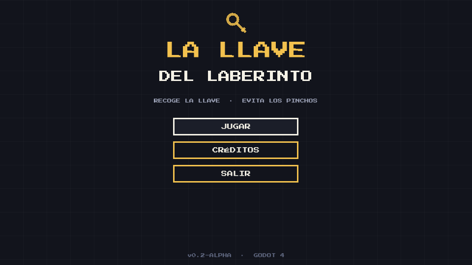
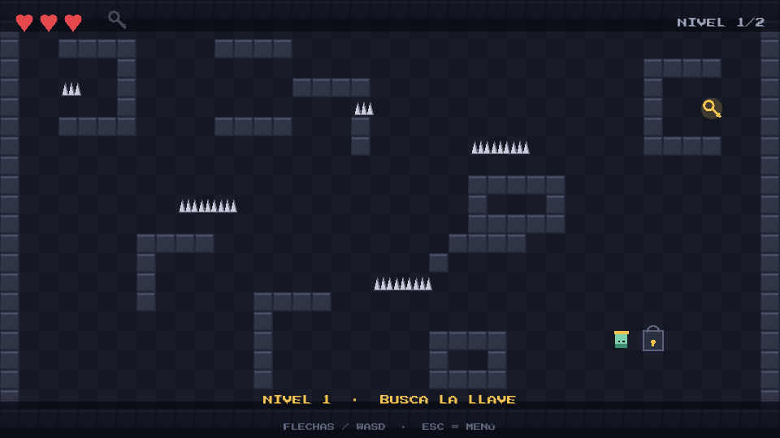
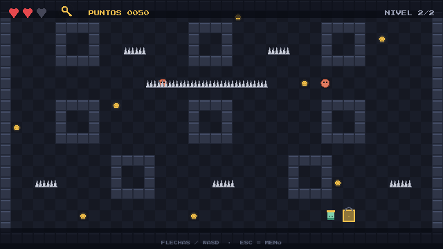
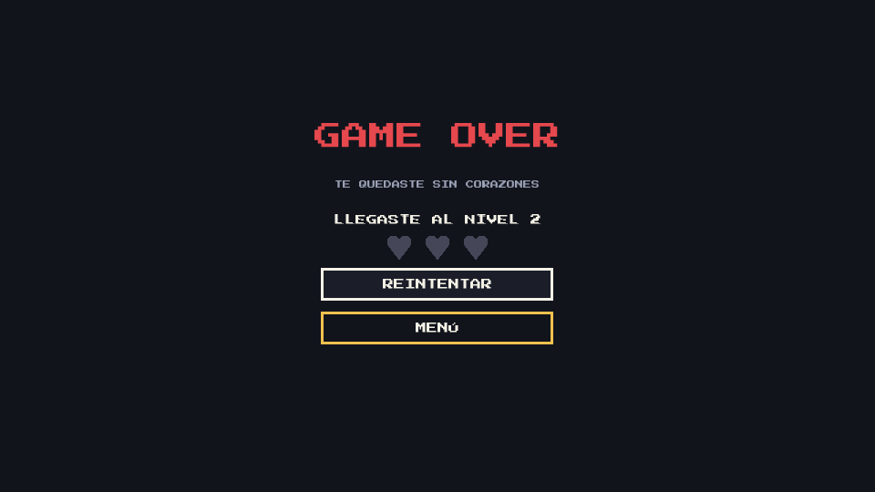
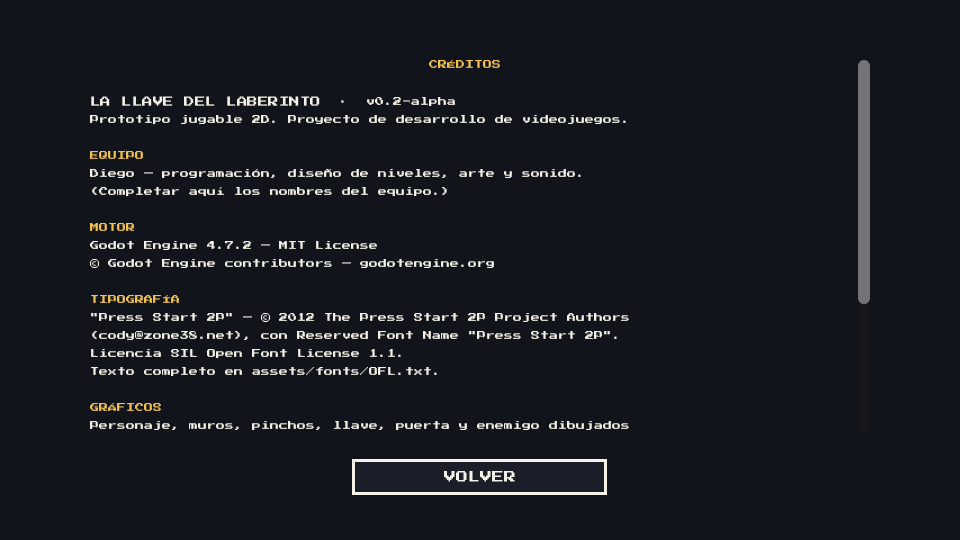

# 🔑 La Llave del Laberinto — `v0.3-beta`

Prototipo jugable 2D hecho con **Godot 4** para la materia de desarrollo de
videojuegos. Recorres dos laberintos, esquivas pinchos y enemigos, recoges la
llave de cada nivel y cruzas la puerta para avanzar. Tienes **3 corazones**:
si los pierdes, *Game Over*.

| Menú | Nivel 1 |
|---|---|
|  |  |

| Nivel 2 | Game Over |
|---|---|
|  |  |



---

[](https://github.com/diegouth/juego2/releases/download/v0.2-alpha/llave-del-laberinto-v0.2-alpha.apk)

Vídeo de demostración: [`docs/video/demo.mp4`](docs/video/demo.mp4) (3:45, 4,9 MB).
Clip individual del integrante jugando: [`docs/video/individual-diego.mp4`](docs/video/individual-diego.mp4) (0:50).

## 👥 Integrantes

| Integrante | Rol | PRs |
|---|---|---|
| **Diego Alejandro Franco Partida** | Programación, diseño de niveles, arte, audio y pruebas | [PR #1](../../pull/1) · [PR #2](../../pull/2) · [PR #3](../../pull/3) |

> Equipo de una persona: cada integrante abre sus ramas `feature/...`, las
> revisa y las fusiona a `main` con un Pull Request (ver
> [Flujo de trabajo](#-flujo-de-trabajo-y-pull-requests)).

---

## ⬇️ Descargar y ejecutar

### Android (recomendado, es el formato entregado)

1. Entra a la sección **[Releases](../../releases)** del repositorio y descarga
   `llave-del-laberinto-v0.2-alpha.apk`.
2. En el teléfono, abre el archivo descargado. Si Android pregunta, permite
   **“Instalar apps de origen desconocido”** para la app de archivos o el
   navegador (es normal: el APK está firmado con una clave de depuración, no
   viene de Play Store).
3. Toca **Instalar** y abre **Llave del Laberinto**.
4. Requisitos: **Android 6.0 o superior** (API 23+), arquitectura
   `arm64-v8a` (cualquier teléfono moderno) o `x86_64` (emulador).

### PC, desde el código (sin instalar nada compilado)

```bash
git clone <URL-del-repositorio>
cd juego2
godot --path .            # o abre project.godot desde el editor de Godot 4.x
```

### Versión web (sin instalar nada)

```bash
./tools/build_web.sh    # exporta a build/web/
./tools/serve_web.sh    # http://localhost:8060/  (cabeceras COOP/COEP)
```

El runtime de Godot usa hilos (`SharedArrayBuffer`), por eso hay que servirlo
con esas cabeceras y no abriendo `index.html` directamente.

### Con `adb` (si tienes el teléfono conectado por USB)

```bash
adb install -r build/llave-del-laberinto-v0.2-alpha.apk
```

---

## 🕹️ Controles

| Acción | Teclado | Táctil (Android) |
|---|---|---|
| Mover | Flechas o `WASD` | Arrastra el dedo en cualquier parte de la pantalla (joystick virtual) |
| Recoger llave / abrir puerta | Automático al tocarlos | Automático al tocarlos |
| Volver al menú | `Esc` | — |

La puerta permanece **cerrada** hasta recoger la llave del nivel; al tocarla
con la llave avanzas de escena. Los **pinchos** y los **enemigos** quitan un
corazón y te devuelven al inicio del nivel, con 1,2 s de invulnerabilidad.

### Puntaje

Cada partida arranca en `PUNTOS 0000` (arriba a la izquierda de la HUD) y suma:

| Acción | Puntos |
|---|---|
| Recoger una moneda | +10 |
| Recoger la llave | +50 |
| Cruzar la puerta | +100 |

El **récord** se guarda en `user://record.cfg` y aparece en el menú y en la
pantalla de fin. Una partida completa de los dos niveles vale 460 puntos.

---

## 🧩 Lo que ya funciona (Fase 1)

- [x] Menú principal con **Jugar / Créditos / Salir**
- [x] Movimiento del personaje en 8 direcciones (teclado y táctil)
- [x] Recolección de la **llave** y **puerta** que cambia de escena (2 niveles)
- [x] **Obstáculos**: pinchos fijos y enemigos que patrullan (rebotan en muros)
- [x] **Sistema de daño y vidas** con 3 corazones, invulnerabilidad y reaparición
- [x] **Game Over** con *Reintentar* (vuelve al nivel 1) y *Menú*
- [x] Pantalla de **créditos** con atribución de motor, fuente, arte y audio
- [x] Audio: música de fondo en bucle y efectos (llave, daño, puerta, game over)
- [x] **Puntaje**: monedas (+10), llave (+50), puerta (+100) y récord persistente
- [x] Diseño de niveles en archivos de texto (`levels/*.txt`)
- [x] **Manual de usuario** ([`docs/MANUAL.md`](docs/MANUAL.md)) y **reporte de pruebas de beta** ([`docs/PRUEBAS-BETA.md`](docs/PRUEBAS-BETA.md))

---

## 🛠️ Cómo compilar el APK

Requisitos: Godot 4.7.x con las *export templates*, JDK 17 y Android SDK
(`build-tools`, `platforms;android-35`, `platform-tools`).

```bash
export JAVA_HOME=/ruta/al/jdk17     # Godot lo toma de sus ajustes de editor
./tools/build_apk.sh                # genera build/llave-del-laberinto-v0.2-alpha.apk
```

En Godot: *Editor → Ajustes del editor → Exportar → Android* (`Android SDK
Path`, `Java SDK Path`, `Debug Keystore`) y luego
*Proyecto → Exportar → Android → Exportar proyecto*.

Los niveles (`levels/*.txt`) se incluyen en el paquete mediante el filtro
`include_filter="levels/*.txt, assets/fonts/OFL.txt"` del preset.

---

## 🧪 Pruebas

```bash
./tools/test.sh
```

Ejecuta `tests/e2e.tscn` en modo headless y comprueba, sin abrir ventana,
**15 casos**: instanciación del nivel, corazones iniciales, presencia de
llave/puerta/pinchos/monedas, recogida de la llave (+50), recogida de moneda
(+10), desaparición del coleccionable, daño del pincho, reaparición en el
inicio, tope de corazones, y avance de nivel al cruzar la puerta con llave.

```bash
# 15/15 en verde
./tools/test.sh
```

Los casos manuales y los defectos encontrados están en
[`docs/PRUEBAS-BETA.md`](docs/PRUEBAS-BETA.md).

---

## 🗂️ Estructura del repositorio

```
project.godot           Configuración del proyecto (escena inicial, autoload, ventana)
export_presets.cfg      Preset de exportación Android (firmado con clave de debug)
scenes/                 Escenas raíz: menú, juego, fin de partida, créditos, jugador
scripts/
  game_state.gd         Autoload: corazones, llave, nivel, entrada y audio
  game.gd               Construye el nivel desde el mapa ASCII, HUD y táctil
  player.gd             Movimiento, daño e invulnerabilidad
  spike.gd / enemy.gd   Obstáculos que quitan corazones
  key_item.gd / door.gd Llave y puerta (cambio de escena)
  coin.gd               Moneda: coleccionable que suma puntaje
  hud.gd                Corazones, llave, nivel, avisos y joystick
  ui_kit.gd             Fuente, botones y dibujo de iconos compartidos
  main_menu.gd / end_screen.gd / credits.gd
levels/level_1.txt      Mapas ASCII (# muro, . suelo, P inicio, K llave, D puerta,
level_2.txt                             ^ pincho, E enemigo)
assets/fonts/           Press Start 2P + licencia OFL
assets/audio/           Música y efectos generados con tools/gen_audio.py
tests/                  Prueba e2e headless y generador de capturas
tools/                  gen_audio.py, build_apk.sh, test.sh
docs/screenshots/       Capturas usadas en este README
docs/MANUAL.md          Manual de usuario (instalación, controles, reglas)
docs/PRUEBAS-BETA.md    Reporte de pruebas de la beta (casos y defectos)
docs/video/demo.mp4     Video de demostración
```

---

## 🌿 Flujo de trabajo y Pull Requests

- `main` siempre jugable; cada aportación entra por una rama `feature/...`.
- Cada PR: revisión propia, descripción de lo que añade y merge con
  `--no-ff` para conservar el historial.
- PRs de esta entrega:

| PR | Rama | Contenido |
|---|---|---|
| [PR #1](../../pull/1) | `feature/nucleo-jugable` | Menú, jugador, nivel 1, llave, puerta, cambio de escena, pinchos, enemigos, corazones, HUD, Game Over |
| [PR #2](../../pull/2) | `feature/creditos-y-release` | Créditos, audio, pruebas e2e, export Android, README y capturas |
| [PR #3](../../pull/3) | `feature/video-y-reporte` | Bot de demostración, vídeo MP4, capturas corregidas y reporte final |
| [PR #4](../../pull/4) | `fix/readme-enlaces` | Enlaces de descarga y nombres del equipo en el README |
| [PR #5](../../pull/5) | `feature/puntaje-y-monedas` | Monedas y puntaje con récord, manual de usuario, reporte de pruebas de beta y capturas nuevas |

---

## 🎵 Créditos y licencias

- **Motor:** [Godot Engine 4.7.2](https://godotengine.org) — licencia MIT,
  © Godot Engine contributors.
- **Tipografía:** “Press Start 2P”, © 2012 The Press Start 2P Project Authors
  (cody@zone38.net), con *Reserved Font Name* “Press Start 2P”. Licencia
  **SIL OFL 1.1** — texto completo en [`assets/fonts/OFL.txt`](assets/fonts/OFL.txt).
- **Gráficos:** dibujados por código con `CanvasItem` (`_draw`), sin sprites
  externos. Autoría del equipo, **CC0 1.0**.
- **Música y efectos:** sintetizados por `tools/gen_audio.py` (ondas cuadradas,
  triangular y ruido). Autoría del equipo, **CC0 1.0**.
- **Código:** MIT (ver [`LICENSE`](LICENSE)).

La misma información aparece dentro del juego en *Menú → Créditos*.
